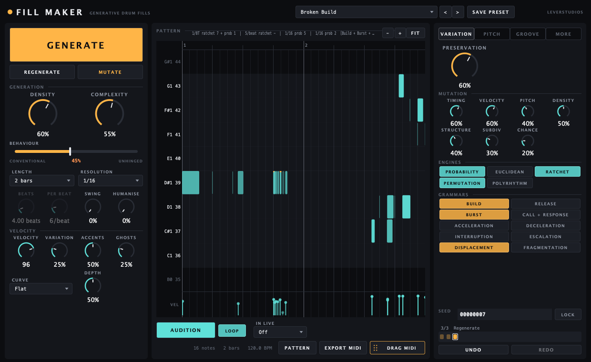

# Fill Maker

A generative MIDI drum fill instrument (VST3, plus AU and a standalone app on macOS) by LeverStudios.
Press **GENERATE**, hear it, regenerate or mutate it, edit notes, then drag it into Live or export it.
Controlled unpredictability: anything from a plain snare roll to 11-against-16 cross-rhythms, 13-hit
ratchets and fills that fall apart on purpose.



## Using it in Ableton Live

1. **Install:** copy `Fill Maker.vst3` to `~/Library/Audio/Plug-Ins/VST3/` (the build below does this
   for you if you run the install step). In Live: Settings > Plug-Ins > Rescan.
2. **Two MIDI tracks** (fits Live Lite):
   - **Track A: Fill Maker** (it's an instrument). If you want groove-aware fills, put your drum
     groove's clip on this track too: Fill Maker hears it and, with **MIDI thru** on (the default),
     passes it along.
   - **Track B: your drums** (a Drum Rack or anything). Set its **MIDI From** to *Track A*, then
     *Fill Maker* in the second menu, and **Monitor: In**.
3. **Hear fills without starting Live:** press **AUDITION** (the built-in preview voice plays it;
   turn on *Audition to MIDI out* in **More** to hear your real kit instead).
4. **Play them with the song:** **In Live: Loop** plays the fill round and round in time with Live;
   **Phrase end** plays it in the last bars of every 2, 4, 8 or 16-bar phrase (a fill before each
   new section).
5. **Keep one:** **DRAG MIDI** into Live's arrangement or a clip slot, or **EXPORT MIDI** to a file.

Keys (when the window has focus): **G** generate, **R** regenerate, **M** mutate, **Space** audition,
**Cmd+Z / Cmd+Shift+Z** undo / redo. In the roll: double-click adds or deletes a note, drag moves
(Alt: off the grid), drag a note's end changes its length, the lane underneath paints velocity, a drag
on the ruler marks a region for Mutate, Delete removes the selection, arrows nudge.

## What's in it

**Generate, Regenerate, Mutate.** Generate makes a new fill from a new seed (the same one when the seed
is **locked**). Regenerate re-runs the current seed with the current settings, so you can turn a knob
and compare. Mutate changes the fill while keeping **Preservation**'s share of it (100% very subtle,
0% close to a new fill), dimension by dimension (timing, velocity, pitch, density, structure,
subdivision, probability); with notes selected, or a ruler region, only there. Every generation and
edit goes into the **history** strip: click any of them, or Undo / Redo.

**Density, Complexity, Behaviour.** Density is how many hits. Complexity brings syncopation, odd
subdivisions (quintuplets, septuplets, 9s, 11s), irregular groupings and displacement. **Behaviour**
runs from CONVENTIONAL (beat-aware weights and accents, familiar subdivisions, engines that keep
going) to UNHINGED (irregular span groupings, odd ratchet counts, extreme velocity drops, random pitch
leaps, clusters, competing cycles). It changes the algorithms' choices, not a randomiser on top.

**Five engines**, each with its own logic; a fill is planned span by span, each span played by one
engine (or two layered):
- **Probability:** weighted chances per step from metric strength, density, the grammar, the groove
  and what just happened (rolls when dense, clusters when unhinged, fewer long holes when
  conventional), with flams and drags.
- **Euclidean:** Bjorklund patterns, on step counts that needn't match the bar (E(5,13) over a bar),
  with a second cycle against the first.
- **Ratchet:** 2, 3, 4, 5, 7, 9, 11 or 13 hits inside an interval; irregular groupings (7 = 3+2+2),
  rising or falling dynamics, accelerating spacing.
- **Permutation:** a motif (fresh, or borrowed from your groove) rotated, reversed, halves swapped,
  its gaps shuffled (same set of gaps), its pitches permuted, fragmented.
- **Polyrhythm:** 3:4, 5:4, 7:8, 11:16, 3:2, 5:3, 7:4, 9:8, anchored to the song so cycles run across
  bar lines (over 1.5 or 2 bars), or repeating 3/5/7-step groupings against the meter.

**Ten rhythmic grammars**, combinable, that shape generation as it happens: Build, Release, Burst,
Call + Response (the second half answers the first, transformed and on other pitches), Acceleration,
Deceleration, Interruption (gaps), Escalation, Displacement (increasingly off the grid) and
Fragmentation.

**Pitch, without assumptions.** Any MIDI pitch 0-127: a **pitch pool** (enable, weight and per-pitch
probability per pitch; default the first 16 Drum Rack pads), a low/high range, and motions:
weighted, repeated, ascending, descending, alternating, random (Auto picks one per phrase).

**Timing and velocity.** Resolutions 1/8 to 1/64, triplets, quintuplets, septuplets or custom (1-32
per beat); positions are kept in double precision and exported at 960 ticks per beat, so nothing is
squeezed onto 16ths. Swing, humanise. Velocity base, variation, accents, ghost notes, and curves
(crescendo, decrescendo, swell, dip, random).

**Groove-aware mode.** From the MIDI on Fill Maker's track (its last two whole bars, kept up to date)
or an imported MIDI file: where it hits, how dense, triplet or straight, velocities, which pitches,
where it leaves space, how repetitive. **Strength** sets how much the fill leans on it: its pitches,
its strong positions and its gaps, its feel, even motifs taken from it.

**Presets and saving.** 19 factory presets (they keep your pitch pool); user presets save everything,
optionally with the pattern (`~/Library/Application Support/LeverStudios/Fill Maker/Presets`).
Patterns save as `.fillpattern` files. The session saves the fill, the history (last 32), the pool,
the seed and the groove.

## Building

Needs CMake 3.22+, a C++20 compiler and JUCE 8 at `~/JUCE` (or `-DFILLMAKER_JUCE_PATH=...`).

```sh
cmake -B build -G Ninja -DCMAKE_BUILD_TYPE=Release
cmake --build build
./build/FillMakerTests_artefacts/Release/FillMakerTests        # all tests
cp -R "build/FillMaker_artefacts/Release/VST3/Fill Maker.vst3" ~/Library/Audio/Plug-Ins/VST3/
cp -R "build/FillMaker_artefacts/Release/AU/Fill Maker.component" ~/Library/Audio/Plug-Ins/Components/
```

`-DFILLMAKER_ENGINE_ONLY=ON` builds just the generator library and its tests (no plug-in).

The command-line tool generates fills without a host:

```sh
fillmaker-cli generate preset="Ratchet Storm" seed=42 out=storm.mid
fillmaker-cli generate density=0.8 behaviour=0.9 engines=ratchet,poly grammars=build,burst
fillmaker-cli snapshot ui.png tab=1
```

`demos/` has a MIDI file from each of 14 presets.

## Design

```
source/engine/    the generator: pure C++ on juce_core, testable without a plug-in
  Pattern         events (position, displacement, length, pitch, velocity, probability, accent, id); JSON
  Settings        everything generation reads
  Rhythm          metric weights, Bjorklund, grids (regular or warped by a grammar)
  Grammar         the plan: density, step scale, intensity, displacement, gaps, bursts over the fill
  Pitch           the pool, weights, motions
  Engines         probability, euclidean, ratchet, permutation, polyrhythm
  Generator       span planning, engine choice and layering, call and response, velocity and timing
  Mutation        preservation-weighted change by dimension, region and selection aware
  Groove          analysis of a source groove; MIDI-file import
  MidiExport      standard MIDI files
  Presets         factory presets, user preset and pattern files
source/playback/  the audio thread
  Player          sample-accurate note-on/off from a musical position; no duplicates, no stuck notes
  PreviewSynth    the audition voice
source/plugin/    the processor (parameters, history, threads) and the editor
```

The message thread does all generation, editing and file work; the audio thread reads the newest
pattern through a lock-free triple buffer and never allocates (MIDI buffers are sized in
`prepareToPlay`).

## Known limitations

- **Not yet tried inside Live itself.** It passes the automated tests, pluginval at strictness 10
  (VST3 and AU, editor tests included) and Apple's auval. The parts that depend on Live (its MIDI From
  routing to a VST3 instrument's output, dragging a file out of the plug-in window into the
  arrangement, and keys reaching the plug-in) still need checking there.
- **Use the VST3 in Live.** Hosts generally don't route MIDI out of AU instruments; the AU is there
  for hosts that do and for previewing.
- **Groove-aware listening needs the groove on Fill Maker's own track** (Live only sends a plug-in
  the MIDI of the track it's on). Otherwise use *Import MIDI file*.
- **Probability:** in Live a note with a probability under 100% plays sometimes; in an exported or
  dragged MIDI file it is decided once, when the file is written.
- **Live usually keeps Space for its own transport,** so use the AUDITION button there.
- **The preview voice is a sketch:** a few synthesised percussion sounds chosen by pitch. Send
  auditions to your kit with *Audition to MIDI out* to hear the real thing.
- Windows: CI builds the 64-bit VST3 and passes the tests and pluginval there, but it hasn't been
  tried in a Windows host yet. The macOS build is ad-hoc signed, so macOS may ask once before opening
  the standalone app.
